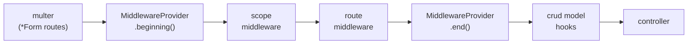

<h1 align="center">@averoa/routes</h1>

<p align="center">
  <b>Laravel-style routes for Express 5.</b><br>
  <code>'Controller@method'</code> strings, named middleware, groups, prefixes and <code>crud()</code> model hooks for
  <a href="https://github.com/budiherma1/averoajs">AveroaJS</a>, compiled into a plain <code>express.Router</code>.
</p>

<p align="center">
  <a href="https://www.npmjs.com/package/@averoa/routes"></a>
  
  = 18.17">
  
  
</p>

---

> **Starting a new project?** Use the [AveroaJS boilerplate](https://github.com/budiherma1/averoajs). It already
> uses this router for `routes/api.js` and `routes/web.js`. This page is the reference for the package itself.

Routes are recorded while you declare them. `init()` loads the controllers, middleware and models from the
application and returns a plain `express.Router`.

## ✨ Highlights

| | |
| --- | --- |
| 🧭 **Readable routes**<br>`router.get('/users/:id', 'UserController@show')` | 🧱 **`crud()` model hooks**<br>404 for unknown ids and 422 validation, before your controller runs. |
| 🚦 **Fails fast**<br>A typo in a controller, method, middleware or model makes `init()` reject with an error naming the route. | 🧩 **Scopes that nest**<br>`group`, `prefix` and `middleware` stack, and are restored even when a callback throws. |
| 📤 **Safe uploads**<br>`*Form` routes use multer 2 with memory storage and a 10 MB default limit. | ⚡ **No `eval`**<br>Real closures on an `express.Router`. Errors and rejected promises reach `next(err)`. |

## 📦 Install

```sh
npm install @averoa/routes express@^5 @averoa/utilities@^2
```

`express` ^5 and `@averoa/utilities` ^2 are peer dependencies.

## 🚀 Usage

```js
// routes/api.js
import Router from '@averoa/routes';

const router = Router();

router.get('/', 'HomeController@index');
router.get('/health', (req, res) => res.json({ ok: true }));
router.post('/login', 'AuthController@login', ['LoginMiddleware']);

router.group({ prefix: 'admin', middleware: ['AuthMiddleware'] }, () => {
  router.crud('Teacher', 'teachers', () => {
    router.get('/', 'TeacherController@findAll');
    router.get('/:id', 'TeacherController@findOne');
    router.post('/', 'TeacherController@create');          // JSON body
    router.postForm('/upload', 'TeacherController@create'); // multipart/form-data
    router.put('/:id', 'TeacherController@update');
    router.delete('/:id', 'TeacherController@delete');
  });
});

export default router;

// somewhere at boot (@averoa/core does this for you)
app.use('/api', await router.init());
```

## 📁 Where things are loaded from

The app root comes from `@averoa/utilities/paths`: the `AVEROA_ROOT` env var,
or the nearest `package.json` above `process.cwd()`.

| What | File | Used as |
| --- | --- | --- |
| `'UserController@show'` | `app/Controllers/UserController.js` | default export: an instance, a class (instantiated once) or an object; `this` is bound |
| `'AuthMiddleware'` | `app/Middleware/AuthMiddleware.js` | default export's `handle` method (configurable), or the export itself if it is a function |
| `crud('Teacher', ...)` | `app/Models/Teacher.js` | default export with static `checkParamId`, `validationRouter`, `mapRequest` |
| global middleware | `app/Providers/index.js` → `MiddlewareProvider` | `beginning()` / `end()` return arrays (or nothing); resolved once at `init()` |

Missing files, methods or hooks make `init()` reject with an error that names the route.

## 📚 API

`Router()` returns a new router definition. Every method returns the router, so calls can be chained.

| Method | Notes |
| --- | --- |
| `get / post / put / patch / delete(uri, handler, middleware?)` | `handler` is `'Controller@method'` or a function; `middleware` is an array of names, functions or objects |
| `postForm / putForm / patchForm(uri, handler, middleware?)` | same, with multipart parsing (`req.files`, `req.body`) |
| `match(verbs, uri, handler, middleware?)` | e.g. `match(['get', 'post'], ...)` |
| `any(uri, handler, middleware?)` | get, post, put, delete, patch |
| `all(uri, handler, middleware?)` | `express.Router#all`; never gets crud hooks |
| `middleware(names, cb)` | middleware for every route declared in `cb` |
| `prefix(prefix, cb)` | path prefix for every route declared in `cb` |
| `group({ middleware, prefix }, cb)` | both at once |
| `crud(Model, prefix, cb)` / `set(...)` | prefix + model hooks (below) |
| `config({ controller, middleware, model, upload })` | see below |
| `async init()` | resolves everything and returns the `express.Router` (same one on every call) |

Scopes nest and are restored when the callback returns (or throws). Callbacks must declare their routes
synchronously. Adding a route after `init()` throws. A handler string without `@` throws as soon as the route is
declared.

The package also has the named exports `Router`, `AveroaRouter` and `DEFAULT_MAX_FILE_SIZE`.

### Order of handlers



```
multer (*Form routes) → MiddlewareProvider.beginning() → scope middleware
→ route middleware → MiddlewareProvider.end() → crud model hooks → controller
```

Thrown errors and rejected promises anywhere in the chain go to `next(err)`.

### crud model hooks

Inside `crud(Model, ...)`:

| Verbs | Hooks |
| --- | --- |
| `post`, `put`, `patch` (and their `Form` variants) | `checkParamId → validationRouter → mapRequest` |
| `get`, `delete` | `checkParamId → mapRequest` |

Each hook is called as `Model.hook.call(Model, req, res, next, additional)` with

```js
{ type: 'json' | 'multipart', create: verb === 'post', pref: '<prefix without slashes>' }
```

`type` is `'multipart'` only for `postForm`/`putForm`/`patchForm`. `pref` is the full prefix with the slashes removed
(`/admin/teachers` → `adminteachers`) and is used as the upload folder name.

The `Model` class of [`@averoa/utilities`](https://github.com/budiherma1/AveroaUtilities) provides these hooks:
`checkParamId` answers 404 and `validationRouter` answers 422.

### config()

```js
router.config({
  controller: { path: 'app/Controllers' },              // default
  middleware: { path: 'app/Middleware', method: 'handle' },
  model: { path: 'app/Models' },
  upload: { limits: { fileSize: 5 * 1024 * 1024 } },    // multer limits
});
```

Every `config()` key is optional.

### Uploads

Uploads use one multer instance with memory storage. `limits.fileSize` defaults to 10 MB, can be set with the
`UPLOAD_MAX_FILE_SIZE` env var (bytes), and `config({ upload })` wins over the env. Too-large files fail with a
`MulterError` (`code: 'LIMIT_FILE_SIZE'`, `status: 413`). Other multer errors get status 400.

## 🧑‍💻 Development

```sh
npm install
npm test
```

`npm test` links `@averoa/utilities/paths` from the sibling `../AveroaUtilities`
checkout (or `$AVEROA_UTILITIES_DIR`) when the package is not installed.

## 🆙 Upgrading from 2.x

3.0.0 is a rewrite. Routes are no longer built as source strings and run with `eval`. The full list of breaking
changes and the migration steps are in [CHANGELOG.md](CHANGELOG.md).

<details>
<summary><b>Highlights</b></summary>

- **Express 5** and **`@averoa/utilities@^2`** are peer dependencies. Path syntax follows path-to-regexp 8
  (`*` wildcards must be named: `/*splat`).
- App files are located with `@averoa/utilities/paths`, and `@averoa/providers` is no longer imported.
- **Scope middleware no longer replaces route middleware.** Both run: scope middleware first, then the route's own.
- **`crud()` `POST` is no longer forced to multipart.** Only the `*Form` routes are multipart, and every hook receives
  the same `additional` object.
- **Errors at `init()`** instead of at request time.
- **Uploads are limited** (10 MB by default).
- **Global middleware is resolved once** at `init()`.
- Trailing slashes are normalised: `crud('Teacher', 'teachers', () => router.get('/', ...))` registers `/teachers`.

</details>

## 🧩 Ecosystem

| Package | What it does |
| --- | --- |
| [averoajs](https://github.com/budiherma1/averoajs) | the boilerplate: start here |
| [@averoa/core](https://github.com/budiherma1/AveroaCore) | builds the Express 5 app and the `averoa` CLI |
| [@averoa/utilities](https://github.com/budiherma1/AveroaUtilities) | Model, Crud, FilterSearch, DB, Mail, Queue, View, Log |
| **[@averoa/routes](https://github.com/budiherma1/AveroaRoute)** | this package |

## 🤝 Contributing

Issues and pull requests are welcome at [github.com/budiherma1/AveroaRoute](https://github.com/budiherma1/AveroaRoute).
Please run `npm test` before you open a pull request.

## License

MIT © Budi Hermawan
